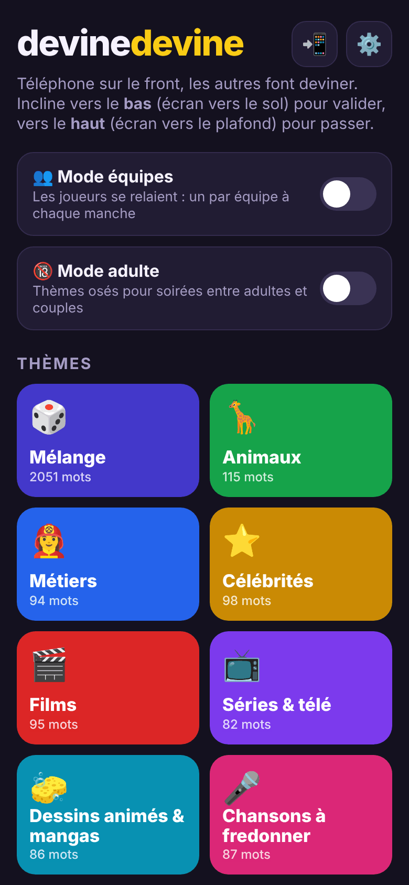
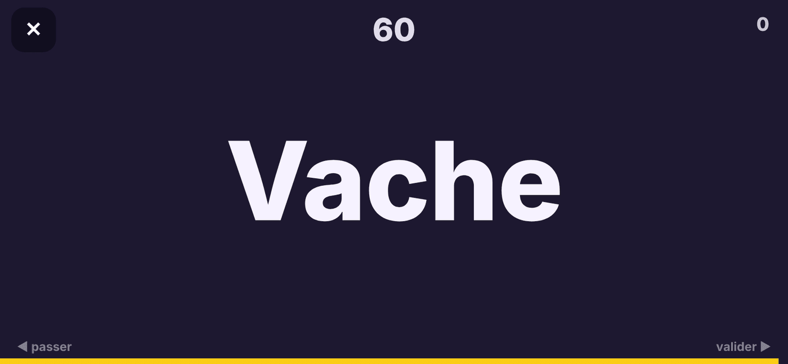

<h1 align="center">devinedevine</h1>

<p align="center">
  <b>Le jeu de soirée où le téléphone se pose sur le front : les autres te font deviner le mot.</b><br>
  Gratuit · sans compte · une seule page HTML · fonctionne hors ligne
</p>

<p align="center">
  
  
  
  
  
</p>

<p align="center">
  <a href="https://funappi.github.io/devinedevine/"><b>Jouer maintenant</b></a>
</p>

<p align="center">
  
  &nbsp;&nbsp;
  
</p>

## Sommaire

- [Comment jouer](#comment-jouer)
- [Fonctionnalités](#fonctionnalités)
- [Ajouter ou mettre à jour des mots](#ajouter-ou-mettre-à-jour-des-mots)
- [Lancer en local](#lancer-en-local)
- [Licence](#licence)

## Comment jouer

1. Choisis un thème, puis tiens le téléphone à l'horizontale sur ton front, écran tourné vers les autres.
2. Les autres te font deviner le mot affiché.
3. Incline vers le **bas** (écran vers le sol) pour valider, vers le **haut** (écran vers le plafond) pour passer.
4. À la fin du chrono, le score et la liste des mots s'affichent.

Si le capteur de mouvement n'est pas disponible, touche la droite de l'écran pour valider et la gauche pour passer.

## Fonctionnalités

- **Thèmes variés** : animaux, métiers, célébrités, films, séries, chansons, marques, sports et bien d'autres, plus un thème Mélange.
- **Mode équipes** : les joueurs se relaient, un par équipe à chaque manche.
- **Mode adulte** : thèmes 18+ pour les soirées entre adultes et couples.
- **QR code de partage** : pour que tout le monde ouvre le jeu en quelques secondes.
- **Mots modifiables sans toucher au code** grâce au fichier `words.json`.
- **Hors ligne** : la dernière liste de mots connue reste utilisable.

## Ajouter ou mettre à jour des mots

Les mots peuvent être modifiés sans toucher au code : édite `words.json` (icône ✏️ sur GitHub, même depuis le téléphone), enregistre (« Commit changes »). Le jeu relit ce fichier à chaque ouverture, ou via Réglages > Mettre à jour les mots.

```json
{"themes":[
  {"id":"animaux","words":["Axolotl","Capybara"]},
  {"id":"noel","name":"Noël","em":"🎄","c":"#15803d","adult":false,"words":["Sapin","Guirlande"]},
  {"id":"metiers","replace":true,"words":["Pompier","Boulanger"]}
]}
```

- `id` d'un thème existant : les mots sont **ajoutés** (ajoute `"replace":true` pour remplacer la liste).
- nouvel `id` avec `name` : nouveau thème (`adult:true` pour le réserver au mode 18+).
- Identifiants existants : animaux, metiers, stars, films, series, dessins, chansons, marques, sports, bouffe, objets, monde, mimes, jeuxvideo, nostalgie, expressions, histoire, web, vacances, nord, contes, musique, coquin, aulit, accessoires, fantasmes, seduction, couple, galeres, mimesx, arrosee.
- Un thème retiré du fichier disparaît à la mise à jour suivante. Hors ligne, la dernière version connue est utilisée.

## Lancer en local

```bash
git clone https://github.com/funappi/devinedevine.git
cd devinedevine
python3 -m http.server 8000
```

Ouvre ensuite `http://localhost:8000`. Un petit serveur est nécessaire pour que `words.json` se charge ; le capteur de mouvement demande en plus une page en HTTPS (comme sur GitHub Pages).

## Licence

[MIT](LICENSE) © 2026 funappi — Made by [Funappi](https://github.com/orgs/funappi/repositories)
